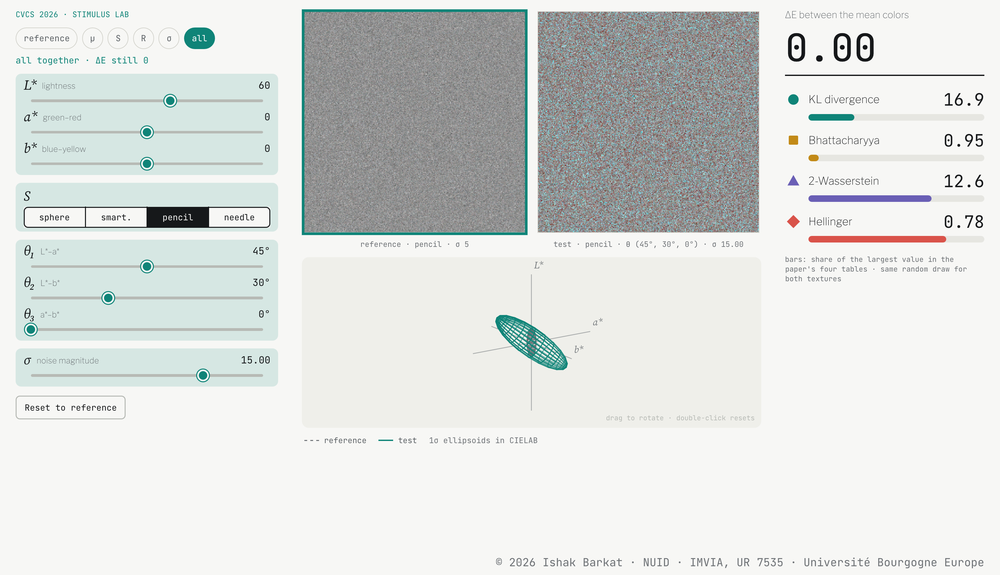
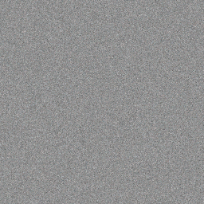
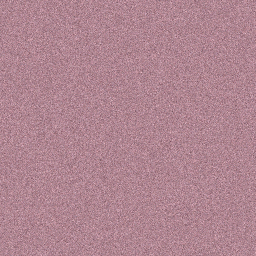
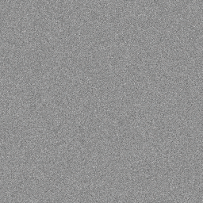
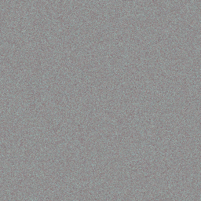
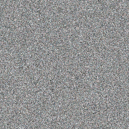

# 3D Gaussian Stimulus Generator · NUID

Interactive companion app to the CVCS 2026 paper
**“Characterization of differences between Gaussian non-uniform color surfaces”**
by Ishak Barkat, Hermine Chatoux and Jean-Baptiste Thomas (Université Bourgogne Europe · IMVIA, UR 7535).

A non-uniform color surface is modelled as a 3D Gaussian distribution in CIELAB, controlled by four parameters:
mean color **μ** = (L\*, a\*, b\*), shape **S**, orientation **R** (three angles θ₁, θ₂, θ₃) and scale **σ**.
For any setting the app renders the test texture next to a fixed grey reference, draws both 1σ ellipsoids in 3D,
and reports in real time the ΔE between the mean colors together with four distribution distances:
Kullback–Leibler, Bhattacharyya, 2-Wasserstein and Hellinger.

*Parameter controls (left), reference and test textures with their 1σ ellipsoids in CIELAB (centre), ΔE and the four
distances (right). Here shape, orientation and scale all change while ΔE stays at 0.*

| reference | μ: a\* = 18 | S: needle | R: θ₁ = 45° | σ: 5 → 15 |
|---|---|---|---|---|
|  |  |  |  |  |
| | ΔE = 18 | ΔE = 0 | ΔE = 0 | ΔE = 0 |

## Download

Go to **[Releases](../../releases/latest)** and download the file for your system:

| System | File | How to open |
|---|---|---|
| Windows 10/11 | `3d-gaussian-gen-windows-x86_64.zip` | Unzip, double-click `3d-gaussian-gen.exe`. If “Windows protected your PC” appears: **More info → Run anyway**. |
| Linux (x86_64) | `3d-gaussian-gen-linux-x86_64.tar.gz` | Extract, then run `./3d-gaussian-gen`. |
| macOS | *coming soon* | Unzip, right-click the app → **Open** → **Open** (the app is not notarised). |

The app runs offline and installs nothing. It needs normal graphics drivers (OpenGL); it may not start over
Remote Desktop or in a virtual machine.

## Use

- Step chips (reference, μ, S, R, σ, all) or the **← / →** keys walk through each parameter.
- Sliders: L\*, a\*, b\*; shape (sphere, smarties, pencil, needle); θ₁ (L\*–a\*), θ₂ (L\*–b\*), θ₃ (a\*–b\*); σ.
- Drag the 3D view to rotate it; double-click to reset.

## Licence

© 2026 Ishak Barkat · NUID · IMVIA, UR 7535 · Université Bourgogne Europe. All rights reserved — see [LICENSE](LICENSE).
The application is distributed as compiled binaries only. Bundled fonts are under the SIL Open Font License 1.1.

Contact: ishak.barkat@ube.fr
